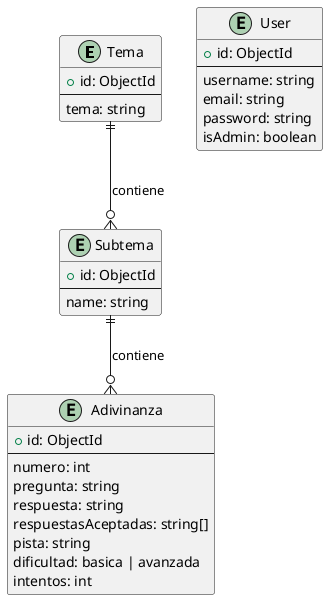

\pagebreak

# Diagrama de la base de datos




## Entidades

- **Tema**
- **Subtema**
- **Adivinanza**
- **User**

## Documentos anidados, no colecciones

Solo hay **dos colecciones** en MongoDB: `temas` y `users`. Subtema y Adivinanza
no son colecciones propias: viven dentro del documento de su tema, como
subdocumentos anidados.

```json
{
  "tema": "Geometría del plano",
  "subtemas": [
    {
      "name": "Ángulos",
      "adivinanzas": [
        { "pregunta": "...", "respuesta": "ángulo recto", "intentos": 5 }
      ]
    }
  ]
}
```

Encaja bien porque el contenido se consulta siempre de arriba abajo (un tema con
todos sus subtemas) y nunca se necesita una adivinanza suelta sin saber a qué
subtema pertenece. Mongo asigna un `ObjectId` propio a cada subdocumento, que es
lo que permite direccionarlos en las rutas de la API.

## Atributos

- **Tema**: `id`, `tema`
- **Subtema**: `id`, `name`
- **Adivinanza**: `id`, `numero`, `pregunta`, `respuesta`, `respuestasAceptadas`,
  `pista`, `dificultad`, `intentos`
- **User**: `id`, `username`, `email`, `password`, `isAdmin`

### Sobre los atributos de Adivinanza

- **`numero`**: el que tiene en el libro original, para poder citar la fuente.
- **`respuestasAceptadas`**: otras formas que también se dan por buenas. Muchas
  respuestas del libro son expresiones completas ("mediatriz de un segmento")
  cuando lo que el jugador teclea es el concepto ("mediatriz").
- **`pista`**: el matiz entre paréntesis del libro. Distingue adivinanzas con la
  misma solución: tres piden "bisectriz", una como eje de simetría y otra por
  distancia.
- **`dificultad`**: las 27 que el autor marcó con asterisco son `avanzada` y
  conceden más intentos.
- **`intentos`**: el **cupo** que concede la adivinanza, igual para todos.

## Lo que no está en la base de datos

Los **puntos y el avance de cada jugador no se guardan aquí**, sino en su
dispositivo. La aplicación se juega sin registrarse, así que no hay cuenta a la
que asociarlos.

Esto corrige un error de la primera versión: la adivinanza guardaba también
`puntos` y `respuestaRevelada`, y el servidor los modificaba conforme se jugaba.
Como la adivinanza es contenido compartido, los fallos de un jugador consumían
los intentos de todos los demás, y al agotarse la respuesta quedaba revelada
para siempre en el temario.

## Relaciones

- Un **Tema** contiene varios **Subtemas**.
- Un **Subtema** contiene varias **Adivinanzas**.
- **User** no tiene relación con las demás: los administradores gestionan el
  contenido, pero no son propietarios de ninguna parte de él.

\pagebreak
